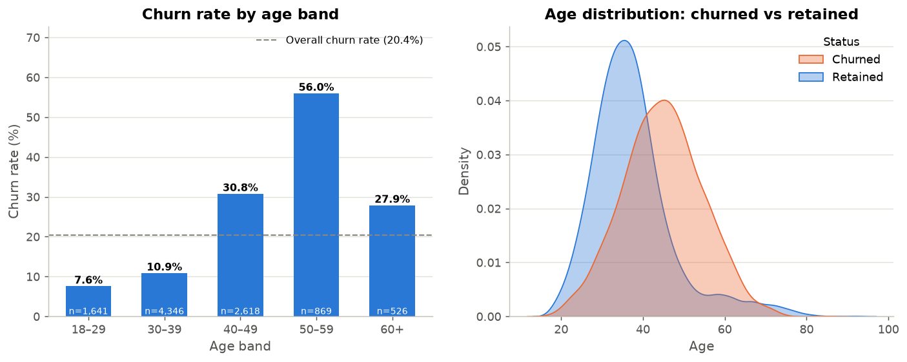
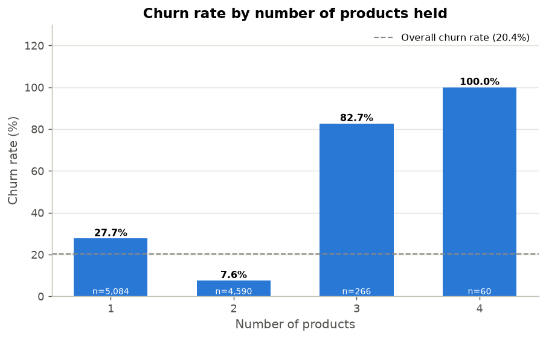
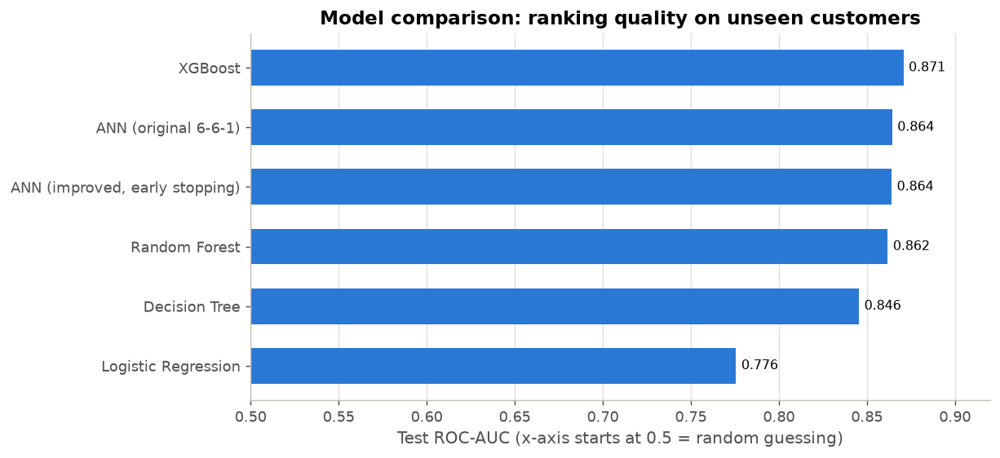
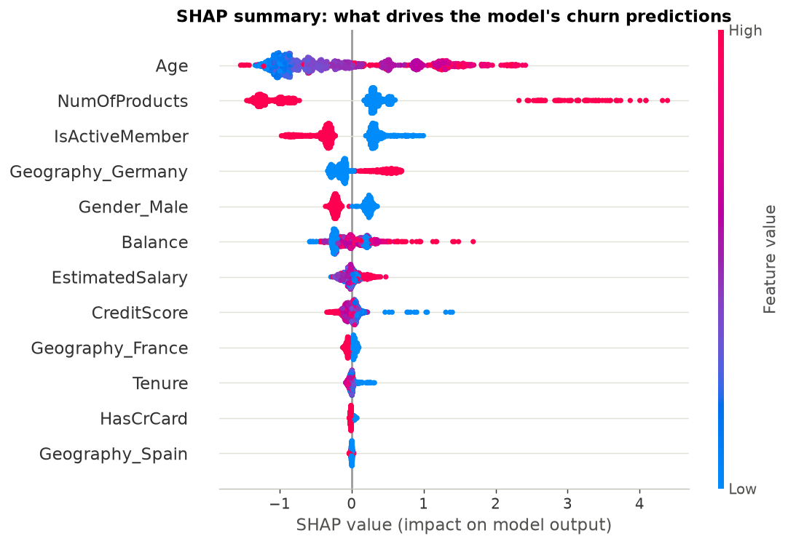
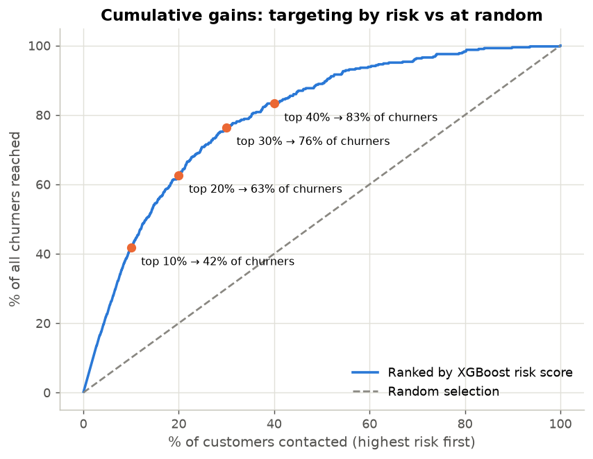

# Bank Customer Churn & Retention Analytics

> **Which bank customers are most likely to churn, what factors are associated with churn, and how can the bank use these predictions to improve customer retention?**

An end-to-end analytics project that combines exploratory analysis, machine learning and business decision-making. It analyses 10,000 retail bank customers, compares five predictive models (including a neural network), explains what drives the predictions, and turns them into a practical retention prioritisation framework and an interactive Streamlit dashboard.

---

## Overview

About **1 in 5 customers (20.4%)** in this dataset left the bank. Winning new customers usually costs far more than keeping existing ones, so a bank wants to identify likely leavers *early* and focus its retention effort where it matters most.

This project approaches the problem the way a business analyst would:

1. **Describe:** who churns, and which customer characteristics are associated with churn?
2. **Predict:** can we identify likely churners in advance, and how reliably?
3. **Explain:** which variables drive the predictions?
4. **Decide:** which customers should the bank prioritise, and with what kind of action?

## Objectives

- Quantify the overall churn rate and identify the highest-churn customer segments
- Measure which characteristics are most strongly associated with churn
- Build and fairly compare baseline, tree-based and neural-network models
- Evaluate models with churn-focused metrics (recall, precision, F1, ROC-AUC), not just accuracy
- Interpret the best model in business language, keeping association, prediction and causation clearly separate
- Translate predictions into risk tiers, a risk × value prioritisation framework and testable recommendations

## Dataset

[`data/churn_modelling.csv`](data/churn_modelling.csv): 10,000 customers of a European retail bank, 14 columns, no missing values. The same dataset was used by the original project (see [Attribution](#attribution)).

| Variable | Description |
|---|---|
| `CreditScore` | Credit score (350–850) |
| `Geography` | Country: France, Germany or Spain |
| `Gender` | Female / Male |
| `Age` | Age in years (18–92) |
| `Tenure` | Years as a customer (0–10) |
| `Balance` | Account balance |
| `NumOfProducts` | Number of bank products held (1–4) |
| `HasCrCard` | Has a credit card (1/0) |
| `IsActiveMember` | Classified as an active member (1/0); the dataset does not define "active" |
| `EstimatedSalary` | The bank's estimate of the customer's salary |
| `Exited` | **Target**: customer left the bank (1/0) |
| `RowNumber`, `CustomerId`, `Surname` | Identifiers; not used as model inputs |

**Limitations:** this is a single snapshot with no dates, currency, product types, transaction history or profitability data. It is widely used for teaching and may be partly synthetic, so findings illustrate a method rather than describe a specific real bank.

## Project structure

```
├── data/
│   ├── churn_modelling.csv          # raw dataset
│   └── processed/                   # fixed stratified train/test split (created by notebook 02)
├── notebooks/
│   ├── 01_eda_customer_churn.ipynb  # who churns? (business questions 1–7)
│   ├── 02_data_preprocessing.ipynb  # data checks, encoding, scaling, train/test split
│   ├── 03_model_comparison.ipynb    # logistic regression, decision tree, random forest, XGBoost
│   ├── 04_ann_model.ipynb           # neural network (original + improved) and final comparison
│   └── 05_business_insights.ipynb   # interpretation, risk tiers, prioritisation, recommendations
├── src/
│   └── churn_utils.py               # shared paths, feature lists, preprocessing, metrics, plotting
├── models/
│   ├── churn_model.joblib           # selected model (preprocessing + XGBoost pipeline)
│   └── model_metadata.json          # parameters, decision threshold, test metrics
├── reports/
│   ├── figures/                     # charts used in this README
│   ├── model_metrics.csv            # test-set comparison of all models
│   ├── test_predictions.csv         # test-set churn probabilities from every model
│   └── retention_priority_list.csv  # ranked customer list with risk tier and suggested action
├── dashboard/
│   └── app.py                       # Streamlit dashboard
├── requirements.txt
├── LICENSE
└── README.md
```

## Analysis

The EDA notebook is built around business questions. Highlights:

| Question | Finding |
|---|---|
| What % of customers churn? | **20.4%** (2,037 of 10,000) |
| Are older customers more likely to churn? | Yes, up to about 60. Churn rises from **7.6%** (18–29) to a peak of **56.0%** (50–59), then falls to 27.9% for 60+ |
| Does the number of products matter? | Strongly, and non-linearly: **2 products → 7.6%**, 1 product → 27.7%, 3 products → 82.7%, 4 products → 100% (small groups: 266 and 60 customers) |
| Does activity matter? | Inactive customers churn at **26.9%** vs **14.3%** for active ones |
| Geographic differences? | **Germany 32.4%** vs ~16% in France and Spain. Germany also has no zero-balance customers, so geography and balance are entangled |
| Gender? | Female customers churn more (25.1% vs 16.5%), and the gap holds in every country |
| Highest-churn segments? | Inactive customers with 3 products (88%), inactive 60+ (86%), inactive 50–59 (81%) |
| Weak or no association | Credit score, estimated salary, tenure, credit-card ownership |

<p align="center">
  
  
</p>

Variables were ranked by strength of association (Cramér's V with chi-square tests). Number of products (0.39) and age (0.36) lead, followed by geography, activity, balance and gender. Number of products has a near-zero *linear* correlation with churn (−0.05) despite the strongest association, which is why the project relies on tree-based models rather than linear ones.

## Machine learning

All models use **the same stratified 80/20 train/test split**, the **same preprocessing pipeline** (one-hot encoding plus standardisation, fit on training data only), and the **same tuning procedure**: a small grid search with 5-fold stratified cross-validation on the training set, selecting by ROC-AUC. The 2,000-customer test set is used only for final evaluation.

| Model | Role |
|---|---|
| Logistic Regression | Interpretable linear baseline |
| Decision Tree | Human-readable rules |
| Random Forest | Ensemble of trees |
| XGBoost | Gradient-boosted trees |
| ANN (original 6-6-1) | The original project's TensorFlow architecture, rebuilt on the shared split |
| ANN (improved) | Larger network with dropout, validation set and early stopping |

## Evaluation

Test set: 2,000 unseen customers, 407 of whom churned. Metrics are for the **churn class** at the default 0.5 threshold.

| Model | Accuracy | Precision | Recall | F1 | ROC-AUC |
|---|---|---|---|---|---|
| **XGBoost** (selected) | **0.869** | 0.787 | **0.489** | **0.603** | **0.871** |
| ANN (original 6-6-1) | 0.863 | 0.775 | 0.457 | 0.575 | 0.864 |
| ANN (improved, early stopping) | 0.864 | 0.808 | 0.435 | 0.566 | 0.864 |
| Random Forest | 0.867 | **0.834** | 0.432 | 0.570 | 0.862 |
| Decision Tree | 0.861 | 0.778 | 0.440 | 0.562 | 0.846 |
| Logistic Regression | 0.807 | 0.617 | 0.142 | 0.232 | 0.776 |
| *Naive baseline: "no one churns"* | *0.796* | *0* | *0* | *0* | *0.500* |

**How to read this:**

- **Accuracy is misleading here.** Predicting "nobody churns" already scores 79.6% while catching zero churners. Logistic regression's 80.7% accuracy hides the fact that it misses 86% of churners.
- **XGBoost was selected by cross-validated ROC-AUC (0.866) before looking at the test set**, and confirmed on it (0.871). The top four models fall within about 0.01 of each other, roughly the size of the cross-validation noise, so the exact ranking shouldn't be over-interpreted.
- **The neural network is competitive but doesn't beat gradient boosting** on this small tabular dataset. Enlarging it didn't help either, which suggests the limit is the information in the 10 features, not model capacity.
- **Recall matters most for retention.** A *false negative* is a churner the bank never tries to keep. A *false positive* costs one unnecessary contact or offer. At the 0.5 threshold XGBoost catches only 49% of churners. Lowering the threshold to **0.25** (chosen on cross-validated training predictions to catch at least 70% of churners) gives **72% recall at 56% precision** on the test set: 94 more churners caught, at the cost of 179 more false alarms.

<p align="center"></p>

## Key insights

1. **Age and number of products are the dominant predictors.** Shuffling either one cuts test ROC-AUC by about 0.12. Activity status, balance and geography add smaller amounts. Credit score, tenure, salary and credit-card ownership contribute essentially nothing.
2. **The relationships are non-linear.** Predicted risk rises sharply from age 40, peaks at 50–60 and falls after about 65. Holding 2 products lowers predicted risk, while 3–4 products raise it sharply.
3. **Inactivity amplifies age-related risk.** Inactive customers aged 50+ churned at over 80%, compared with 37% (50–59) and 13% (60+) for active customers of the same age.
4. **Risk is concentrated.** The High-risk tier (predicted ≥ 60%) is **8.9% of customers** but has an **87.7% actual churn rate** and contains **39% of all churners**.
5. **Targeting beats random outreach.** Contacting the **top 10%** of customers by predicted risk reaches **42% of churners** (4.2× lift). The **top 20%** reaches **63%** (3.1× lift).
6. **The probabilities are well calibrated.** Predicted and actual churn rates line up across risk groups, so the scores can reasonably be read as approximate churn likelihoods.

<p align="center">
  
  
</p>

> **Association ≠ prediction ≠ causation.** The EDA shows *associations*, and the model shows which variables help *predict* churn. Neither shows that changing a variable (e.g. making a customer active) would *cause* them to stay. Inactivity might be a symptom of a customer who has already decided to leave. Causal effects require controlled experiments.

## Business recommendations

**Retention prioritisation framework (risk × value)**

Not every predicted churner deserves the same response. The dataset has **no revenue or profitability data, so customer lifetime value cannot be calculated**. Account balance is used as a rough, explicitly assumed proxy for relationship value.

```
                          PREDICTED CHURN RISK
                   Lower (< 25%)            Higher (≥ 25%)
                ┌──────────────────────┬──────────────────────┐
  Higher value  │  NURTURE             │  PRIORITY OUTREACH   │
  (balance ≥    │  684 customers       │  323 customers       │
   median)      │  10% actual churn    │  57% actual churn    │
                │  24% of churned bal. │  65% of churned bal. │
                ├──────────────────────┼──────────────────────┤
  Lower value   │  STANDARD            │  AUTOMATED ENGAGEMENT│
  (balance <    │  790 customers       │  203 customers       │
   median)      │  6% actual churn     │  54% actual churn    │
                │  3% of churned bal.  │  7% of churned bal.  │
                └──────────────────────┴──────────────────────┘
                     (2,000 test customers)
```

**Recommendations.** These are hypotheses to test, not proven interventions.

1. **Score customers regularly and focus effort on the highest-risk segment.** The top 10–20% by risk reach 42–63% of churners.
2. **Match the cost of the intervention to risk and value.** Use relationship-manager outreach and tailored offers for *Priority outreach* customers, and low-cost automated nudges for *Automated engagement*.
3. **Re-engage inactive customers, especially those over 40**, with personalised engagement campaigns.
4. **Offer relevant product recommendations to single-product customers.** 2-product customers churn least, though this is an association, not proof that cross-selling retains customers.
5. **Investigate customers with 3–4 products as a service-quality issue** (83–100% churn) *before* expanding cross-selling.
6. **Research the higher churn in Germany and among female customers.** The data shows the gaps but not the reasons.
7. **Validate every intervention with a randomised control group** to measure true uplift. Scale an intervention only when *P(churn) × P(intervention works) × customer value > cost*. The model supplies only the first term.

A customer-level output is exported to [`reports/retention_priority_list.csv`](reports/retention_priority_list.csv).

## Dashboard

An interactive Streamlit app with four pages:

- **Overview:** total customers, churned customers, churn rate, churned-vs-retained averages and key segment charts
- **Customer analysis:** filter by country, gender, age range, activity and number of products, and see how churn changes across any breakdown
- **Churn risk predictor:** enter a customer's details to get a churn probability, a risk level (Low / Medium / High) and the suggested retention approach from the framework, with a clear note that this is an estimate, not a guarantee
- **Model performance:** comparison of all models and the selected model's trade-offs

```bash
streamlit run dashboard/app.py
```

Run it from the project root. It opens at http://localhost:8501. The trained model is included in `models/`, so the dashboard works without re-running the notebooks.

## How to run the project

```bash
git clone https://github.com/<your-username>/bank-customer-churn-ann.git
cd bank-customer-churn-ann
python3.12 -m venv .venv
source .venv/bin/activate          # Windows: .venv\Scripts\activate
pip install -r requirements.txt
jupyter notebook notebooks/
```

Run the notebooks in order (01 → 05). Notebook 02 creates the train/test split, notebook 03 trains and saves the selected model, and notebooks 04–05 build on those outputs. All paths are relative to the project, so it works from any location.

**Notes**
- Tested with **Python 3.12**. TensorFlow 2.21 supports Python 3.10–3.13 (not 3.14 at the time of writing).
- **macOS:** XGBoost needs the OpenMP runtime. If `import xgboost` fails with a `libomp.dylib` error, run `brew install libomp`.
- Neural-network results can vary slightly (about ±0.005 ROC-AUC) across machines and TensorFlow versions, even with fixed seeds. All other results are deterministic.

## Tech stack

Python · pandas · NumPy · SciPy · Matplotlib · Seaborn · scikit-learn · XGBoost · TensorFlow/Keras · SHAP · Streamlit · Altair

## Attribution

This project builds on [**sinanw/ann-bank-customer-retention**](https://github.com/sinanw/ann-bank-customer-retention) (MIT License, © 2024 sinanw), which provided the dataset, the original preprocessing approach (dropping identifiers, encoding `Gender`/`Geography`, train-only feature scaling) and the 6-6-1 artificial neural network architecture in TensorFlow and PyTorch. The original ANN is credited and rebuilt in [`04_ann_model.ipynb`](notebooks/04_ann_model.ipynb).

This version extends that work with exploratory and statistical analysis, a refactored leakage-safe preprocessing pipeline, a multi-model comparison with cross-validated tuning, decision-threshold analysis, model interpretation (permutation importance, SHAP), calibration, risk segmentation, a retention prioritisation framework, business recommendations and a Streamlit dashboard.

The original MIT [LICENSE](LICENSE) is retained unchanged.
